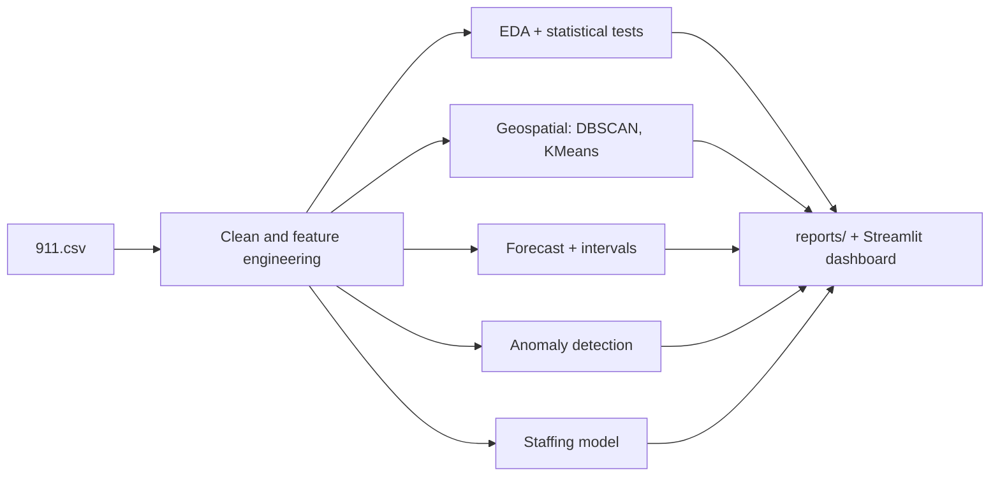

# 🚨 911 Emergency Call Analytics
### From call patterns to staffing decisions

  

> **Business question:** How should a dispatch center staff and position resources, given *when*, *where* and *what kind* of 911 calls arrive?

<!-- Add a dashboard GIF or screenshot here: docs/dashboard.gif -->

## Headline results
<!-- Run the pipeline on the real data, then paste reports/key_findings.md here. Keep 4-6 bullets. -->

## What makes this more than EDA
| Layer | Technique | Why it matters |
|---|---|---|
| Statistics | Mann-Whitney, chi-square, **effect sizes** (rank-biserial, Cohen's d, Cramér's V) | p-values alone are meaningless at n > 500k |
| Geospatial | DBSCAN with haversine distance, KMeans coverage curve, Folium + pydeck | Finds hotspots and shows diminishing returns of extra stations |
| Forecasting | 24h-ahead GBM vs seasonal-naive baseline, **quantile prediction intervals**, rolling-origin CV | Leak-free features, calibrated uncertainty |
| Anomalies | Robust z-score (median/MAD) vs weekday baseline | Surfaces unusual days without outliers skewing the threshold |
| Decision layer | Percentile-demand staffing planner with adjustable assumptions | Turns analysis into an actionable roster |
| Data quality | Automated audit: duplicates, bad timestamps, GPS outliers, coverage gaps | You find data problems before they find you |
| Model rigor | Feature-group **ablation**, permutation importance, holiday features, hotspot stability | Shows *why* the model works, not only that it does |
| Engineering | Modular `src/`, pytest (incl. a **leakage test**), ruff, pre-commit, Docker, GitHub Actions CI, run metadata | Reproducible and reviewable |

## Architecture


## Dashboard
Six tabs: **Overview**, **Demand patterns**, **Geospatial** (3D hexbin map), **Forecast** (with intervals and error by hour), an interactive **Staffing planner** (change percentile, handling time and utilization; download the roster), and **Method & caveats**.

## Quick start
```bash
pip install -r requirements.txt
# download 911.csv from Kaggle (mchirico/montcoalert) into data/
make run          # or: python run_pipeline.py --data data/911.csv
make app          # launches the dashboard
make test
make lint
```
Or with Docker: run the pipeline once locally, then `make docker` and open http://localhost:8501.

Prefer a narrative? Open `notebooks/01_analysis_walkthrough.ipynb`.
No data yet? `make sample` creates **synthetic** data (`data/911_sample.csv`) so you can smoke-test. Never report results from it.

## Project structure
```
src/            data.py  quality.py  eda.py  stats_tests.py  geo.py  forecast.py  anomalies.py  staffing.py  config.py
notebooks/      01_analysis_walkthrough.ipynb
app/            dashboard.py            Streamlit app
tests/          test_core.py            cleaning, leakage, staffing, anomaly tests
scripts/        make_sample_data.py     synthetic data for smoke tests
reports/        figures, map, CSV/JSON outputs, key_findings.md (generated)
run_pipeline.py                         end-to-end runner
```

## Design decisions
- **Forecast horizon = 24h.** All features are lagged ≥24h, so the model could be run a day ahead. A test proves features at time *t* never see data from *t* onward.
- **Chronological validation only.** Random splits leak the future in time series.
- **WAPE and MAE, not MAPE.** Hourly counts get small, which blows up MAPE.
- **Prediction intervals.** The 80% interval is checked against its empirical coverage, so you can see whether the uncertainty is trustworthy.
- **Median/MAD anomaly detection.** Mean/std thresholds get inflated by the very outliers you are hunting.

## Model card (forecast)
- **Task:** predict hourly call count 24 hours ahead. **Model:** histogram gradient boosting with Poisson loss, plus 10th/90th percentile quantile models for the interval.
- **Features:** calendar (hour, weekday, month, weekend, US federal holiday) and lags (24h, 48h, 168h, trailing weekly mean shifted by 24h).
- **Evaluation:** last 60 days held out, plus 4 rolling-origin folds; compared with "same hour last week".
- **Not suited for:** dispatching individual calls, or forecasting during unprecedented shocks (e.g. a pandemic onset), since the model only learns patterns seen in training.
- **Reading the ablation:** if lag features add little, the calendar alone explains most of the signal; report whichever you actually observe.

## Limitations
- Staffing depends on **assumed** handling time and utilization (`src/config.py`); the dataset has no unit or response-time fields.
- KMeans placement ignores road networks and existing stations.
- Anomalies are detected, not explained; attributing them (weather, holidays, events, reporting changes) needs external data.
- Single county; results may not generalise.

## Roadmap
SARIMA/Prophet benchmark · weather features · response-time analysis if data allows · hosted demo (Streamlit Community Cloud).
